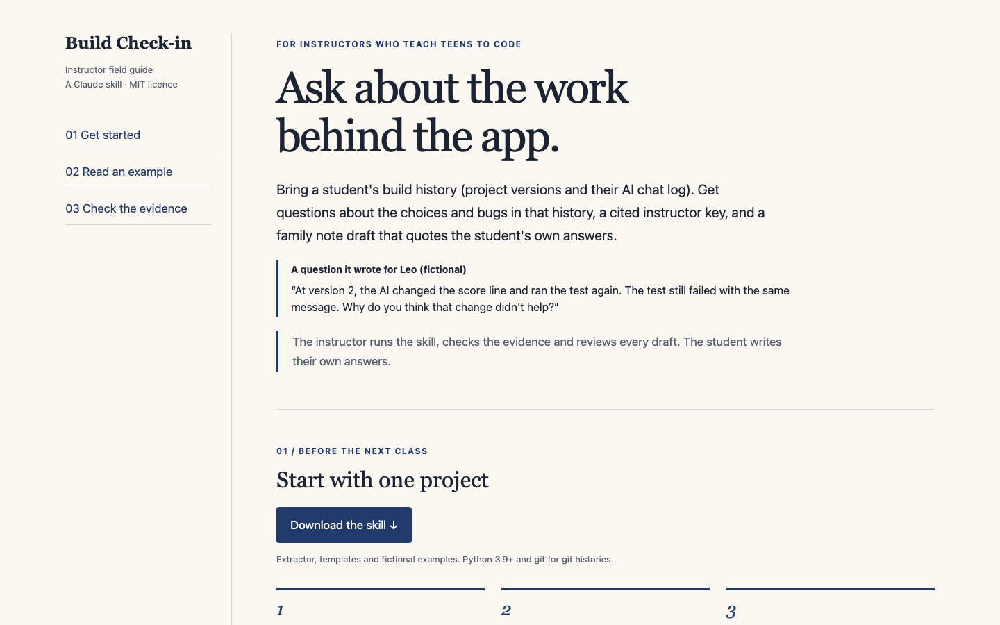

# Build Check-in

**Ask about the work behind the app.** For instructors who teach teens to code.

Build Check-in helps a coding instructor who teaches teens turn a student's build history (project versions and their AI chat log) into questions about specific moments in the work, a cited instructor key, and a private account of what the AI did. After the instructor supplies the student's answers, it drafts a five-line family note and returns the student's own words in build order for a project showcase. It also makes classroom debugging drills when the family has agreed, and a class list of each student's unresolved errors.

A question it wrote for a fictional student, Leo, from his build history:

> At version 2, the AI changed the score line and ran the test again. The test still failed with the same message. Why do you think that change didn't help?

**[Open the instructor field guide](https://nickkklian.github.io/build-check-in/)** · [Download build-checkin.zip](build-checkin.zip) · [Read the examples](build-checkin/examples/)

[](https://nickkklian.github.io/build-check-in/)

## Worked fictional example

Leo's fictional Pixel Hop game restores a score of 5, then displays 51 after a hop. The history records an AI edit that failed and Leo's report of a later hand edit. Step 1 gives the instructor the question quoted at the top of this page, from a recorded model run on the fictional fixture.

The instructor key links it to the recorded edit and failing result. Leo writes his own answer. The bundled step2-answers.md and step2-output.md illustrate how an instructor supplies answers and receives a family note draft. Step-2 and drill examples were written by hand. The questions and key are real model output on this fictional history. All example people and projects are fictional.

Read build-checkin/examples/. For the class list, fill build-checkin/class-list-template.json and run scripts/class_list.py with its path. It prints cited unresolved failures, unchanged versions, repeated errors and returned-answer counts in manifest order.

## Install for Claude Code

Download build-checkin.zip from this project and unzip it. Copy the enclosed build-checkin folder into your Claude Code skills directory, typically ~/.claude/skills/. Invoke /build-checkin and specify step 1, step 2, debug drill, or class list. The same skill folder is also included directly in this repository.

Python 3.9 or newer is needed for the helpers, with git available for git histories. Helpers use the standard library. Run commands from the installed build-checkin folder. Fill context-template.json with the confirmation that an adult runs the skill, the project context and the classroom agreement (the family's permission to use a bug in class). Supply only paths you intend the extractor to read. Keep histories and outputs in a private working directory.

```sh
python3 scripts/extract_history.py PROJECT --context CONTEXT.json --session SESSION.jsonl --out PRIVATE/history.json
```

A pasted USER/ASSISTANT chat or ordered snapshots can be supplied instead. SKILL.md documents the arguments.

## What it changes

The same fictional histories, which the skill was revised on, went to Claude Sonnet 5.5 with a one-line plain prompt and with the skill, three times per arm:

| Check | Plain prompt | Skill |
| --- | --- | --- |
| Family note credits work the history does not show | 9 of 27 | 0 of 27 |
| Questions give away or hint at the fix | 36 of 36 | 0 of 36 |
| Drill made without family agreement | 8 of 15 | 0 of 15 |

On six new held-out fictional projects, the skill's debugging drills met every reviewed requirement 6 of 6 times; the same model given the complete written rules as a prompt managed 4 of 6 (questions: 2 of 6 against 1 of 6; family-note step: 3 of 6 against 1 of 6). All cases are fictional and written by the author; no real student history has been tested. Method, limits, remaining errors and the next round are in [verification/RESULTS.md](verification/RESULTS.md).

## Review and consent

An adult operates the skill. Students write their own answers. Outputs stay drafts until an instructor reviews them, and the instructor approves family notes. Classroom drills require the family's agreement and remove identifying details. Suspected pasted answers prompt an instructor conversation. Attribution follows recorded evidence, with self-reports and unknown authorship kept explicit.

## Privacy

The extractor reads only the paths you supply. It skips symlinks, dependencies and credential-like files, and redacts common token patterns. Review records before sharing them. Recorded tests are reports. The extractor never executes project code. Keep histories and outputs in a private working directory.

## Local checks

Run python3 scripts/check.py for archive and helper checks. Run python3 scripts/check-release.py --denylist PATH for the privacy and offline audit, using a private policy kept outside the release. Run sh verify-local.sh for browser interactions and 390/1440 layouts with installed headless Chromium. Reports are in verification/.

## Licence

MIT. See LICENSE.
